# PFA API

A demonstration project by Marc Rasmussen: a multilingual text-embedding API with an accompanying harness for AI-assisted development.

The API turns questions and documents into vectors, splits long documents into chunks, and ranks candidate passages by semantic similarity. A Danish question can, for example, retrieve a relevant English passage. The engineering case study is how to make that capability maintainable: explicit feature boundaries, consistent API behaviour, observable model serving, and checks that hold both human and agent changes to the same rules.

**Stack:** Python · FastAPI · Pydantic · sentence-transformers / PyTorch · Docker · GitHub Actions

[What this demonstrates](#what-this-demonstrates) · [Quick start](#quick-start) · [Try the demo](#try-the-demo) · [Architecture](#architecture) · [Agent harness](#the-agent-harness) · [Development](#development) · [Documentation](#documentation)

## What this demonstrates

| Engineering concern | Approach in this project | Where to inspect it |
|---|---|---|
| API design | Validated requests, documented examples, RFC 9457 Problem Details, and compatibility checks against the saved OpenAPI contract | [Service reference](docs/service.md), [OpenAPI](docs/openapi.json) |
| Model integration | Tokenizer-aware chunking, query/passage prefixes, normalized vectors, and ranking across languages | [Chunking and embedding design](docs/architecture.md#chunking--the-models-512-token-window), [API scenarios](tests/e2e/) |
| Modular architecture | Features expose messages and results through public contracts; a bus dispatches requests to their handlers | [Architecture walkthrough](docs/architecture.md#one-request-end-to-end), [feature contracts](src/pfa/features/) |
| Operational behaviour | Separate liveness and readiness probes, background warm-up, bounded inference concurrency, and logs correlated by trace ID | [Runtime behaviour](docs/service.md#running-in-production), [logging decision](docs/decisions/0001-logging.md) |
| Verification and delivery | Tests with fake model components, scenarios using the real model, architecture checks, dependency auditing, and verified container builds | [Tests](tests/), [build workflow](.github/workflows/ci.yml) |
| AI-assisted development | Task-specific instructions, measured context budgets, feedback during edits, and a separate automated review pipeline | [Harness overview](#the-agent-harness), [review guide](harness/guides/pr-review.md) |

For a short review, run the similarity example below, follow [one request through the architecture](docs/architecture.md#one-request-end-to-end), then inspect the [CI workflow](.github/workflows/ci.yml) and [harness design](docs/tooling.md#heimdall--the-harness).

## Quick start

Requires **Python 3.10+**. Run from a checkout of this repository. The commands below use a macOS/Linux shell:

```bash
python3 -m venv .venv
source .venv/bin/activate
python -m pip install -e ".[dev]" -e ./tools
python -m pfa.api
```

On Windows PowerShell, create the environment with `py -m venv .venv`, activate it with `.venv\Scripts\Activate.ps1`, then run the same install and start commands.

Open [the interactive API docs](http://127.0.0.1:8000/docs). Each operation includes a request example and a **Try it out** option. The live schema is at [OpenAPI JSON](http://127.0.0.1:8000/openapi.json); a [saved copy](docs/openapi.json) is available without starting the service.

**Allow for the first model load.** The default model, `intfloat/multilingual-e5-large`, produces normalized, 1024-dimensional vectors. Components load on demand, and the first embedding request may download approximately **2.2 GB** of weights before it can answer. To download the default model ahead of a demonstration:

```bash
python tools/download_model.py
```

Downloading fills the disk cache; loading the model into memory still happens when the service uses it. Set `PFA_WARMUP=1` to start loading in the background at startup. `/health` answers while loading; `/ready` returns `200` once both tokenizer and model are loaded. With warm-up off, polling `/ready` alone does not trigger a load.

A GPU is optional. For NVIDIA GPU use, install the appropriate CUDA build of PyTorch **before** the project dependencies; see [model configuration](docs/service.md#the-model). A service-only installation uses `python -m pip install .`.

## Try the demo

With the service running, send this request from another terminal, or use the same JSON in `/docs`:

```bash
curl --request POST http://127.0.0.1:8000/embeddings/similarity \
  --header 'Content-Type: application/json' \
  --data '{
    "question": "Hvordan nulstiller jeg min adgangskode?",
    "candidates": [
      "To reset your password, open Settings and choose Security.",
      "Opening hours: Monday to Friday, 9 to 17."
    ]
  }'
```

The Danish question asks how to reset a password. The response ranks the English password instructions first. This example is also covered by the [embeddings scenarios](tests/e2e/embeddings.feature).

Example response from the documented model run; exact scores can vary:

```json
{
  "model": "intfloat/multilingual-e5-large",
  "matches": [
    {
      "source_index": 0,
      "text": "To reset your password, open Settings and choose Security.",
      "score": 0.8112,
      "chunk_index": 0,
      "chunk_count": 1
    },
    {
      "source_index": 1,
      "text": "Opening hours: Monday to Friday, 9 to 17.",
      "score": 0.7306,
      "chunk_index": 0,
      "chunk_count": 1
    }
  ]
}
```

`source_index` identifies the original candidate; `matches` are ordered by score. A long candidate is split and scored by its best chunk, whose text and position are returned. Compare scores within a response; they are similarity values, not confidence percentages.

To inspect an error, try an empty `candidates` array. The API returns `422` with an `application/problem+json` document identifying the invalid field and a `trace_id` for finding the request in the logs.

## Endpoints

| Method | Path | Purpose |
|---|---|---|
| GET | `/health` | Liveness: the process is responding. |
| GET | `/ready` | Readiness: tokenizer and model are loaded; otherwise `503`. |
| POST | `/chunking/split` | Split text within a token budget, using the model's tokenizer. |
| POST | `/embeddings/query` | Turn a question into one query vector. |
| POST | `/embeddings/passages` | Embed documents, returning one vector per chunk with its source and position. |
| POST | `/embeddings/similarity` | Rank supplied candidates against a question, best match first. |

For a retrieval application, embed documents with `/embeddings/passages` and store the returned vectors in your own index. Embed each question with `/embeddings/query`, then rank the stored vectors by cosine similarity. `/embeddings/similarity` combines embedding and ranking when the candidate texts are already available. The service adds the model's query and passage prefixes for callers.

See the [service reference](docs/service.md) for request limits, error types, settings, and deployment details.

## Docker

With Docker and Compose installed:

```bash
docker compose up --build
```

The service is available on port `8000`. Compose uses CPU inference, enables background warm-up, and keeps the model cache in a named volume. Wait for [readiness](http://127.0.0.1:8000/ready) to return `200` before the demonstration. `/health` is the container's liveness check.

The multi-stage image runs as a non-root user and contains the service package. Development tooling is packaged separately; CI checks that it is excluded from both the service wheel and the image. See [container settings](docs/service.md#the-image) for GPU builds and preloaded weights.

## Architecture

The application has two **vertical slices**: chunking and embeddings. Each owns its contract and implementation. Embeddings depends on chunking's public contract; feature logic stays independent of FastAPI and Pydantic.

A request follows this path: **HTTP route → contract message → bus → feature handler → result → HTTP response**. When embeddings needs chunking, it dispatches a chunking message on the same bus. Dependencies are declared in each feature's `feature.json` and checked by Eitri.

```text
src/pfa/
  application.py       Registers the features on one bus
  api/                 HTTP entry point, validation, errors, and logging
    routes/            One routes module per feature, plus health probes
  features/
    chunking/          Token counting and text splitting
    embeddings/        Query/passages embeddings and similarity ranking
  kernel/              Shared Result, Bus, Query, and Command primitives
```

This makes the intended working set explicit: one feature, its dependencies' contracts, the kernel, and its HTTP adapter when needed. The trade-off is more messages and wiring than a small API strictly requires; here they provide boundaries that can be checked as the project grows. The [architecture reference](docs/architecture.md) explains the dependency rules and traces a complete request.

## The agent harness

The harness is the second part of the demonstration: an experiment in making architectural expectations visible and enforceable during AI-assisted development.



[Editable diagram source](docs/diagrams/harness.mmd)

| Component | Role |
|---|---|
| **AGENTS.md and task guides** | Identify the owning feature, its allowed working set, and the steps for a change. |
| **Heimdall** | Generates the feature map, observes supported agent tool activity, reports drift, runs scenarios, and coordinates review. |
| **Eitri** | Enforces dependency boundaries, framework separation, contract compatibility, and a 15,000-token context budget per feature. |
| **Brokkr** | Supplies the token estimator; its canary suite verifies that deliberate architecture violations are rejected. |
| **Jev and Claude** | Jev answers narrow fault checks about changed functions. In the PR pipeline, Claude verifies failing and uncertain checks against the changed files. |

The context budget counts a feature's own source, the public contract surfaces of its dependencies, and the kernel. A dependency's private implementation adds no cost to its consumer; a larger kernel costs every feature. This encourages small contracts and focused features. The [budget calculation](docs/tooling.md#how-the-token-budget-works) and [estimator calibration](docs/calibration.md) explain the measure and its limits.

Gherkin scenarios describe externally observable behaviour. Matching Postman requests assert each `Then` clause by name. `heimdall e2e` checks the pairing, starts the real service, runs the selected requests, and stops it. This complements the default test suite, which uses fake model components.

The configured **Claude Code hooks** provide feedback during edits and checks when an agent stops. Observation requires a generated map and supported tool events; shell reads are invisible to these hooks. Other environments can run the checks explicitly. Automated review returns `comment`, `request_changes`, or `escalate`; a person decides whether to merge. Its value still needs to be assessed against human review outcomes.

### Run the harness

After the development installation in [Quick start](#quick-start):

```bash
heimdall map --root .          # Generate the map used by the hooks
python tools/brokkr_canary.py  # Verify that deliberate violations fail
python tools/smoke_test.py     # Exercise the harness through the real hook
heimdall drift                # Inspect recorded sessions, when available
```

For automated review, set `TYPESAFE_API_KEY` in your environment, then run:

```bash
heimdall review --base origin/main --task "Describe the intended change"
```

The PR workflow adds Claude verification with `ANTHROPIC_API_KEY`. If the Jev key is unavailable, CI reports the review as skipped. See [the review guide](harness/guides/pr-review.md) for credentials, outcomes, and policy, and [development tooling](docs/tooling.md) for the full harness design.

## Development

Read [AGENTS.md](AGENTS.md) and the relevant [task guide](harness/README.md) before changing code. Use `.venv` as the environment name so the configured Claude Code hooks can find its interpreter.

Run the required checks from the activated development environment:

```bash
ruff check .
ruff format --check .
mypy
pytest
eitri check --root . --base origin/main
```

The default tests use fake model components and do not download embedding weights. They cover API behaviour and tooling; they also check the repository's relative Markdown links. The `origin/main` reference must be available for comparisons against the main branch.

To run the scenarios with the real model, install the [Postman CLI](https://learning.postman.com/docs/postman-cli/postman-cli-installation/), download the default model, then run:

```bash
python tools/download_model.py
heimdall map --root .
heimdall e2e --all
```

Heimdall starts and stops its own service on a free port and waits for `/ready`; no manually started service or Postman login is needed. Use `heimdall e2e --base origin/main` to run the scenarios affected by a change. See [the scenario guide](harness/guides/e2e-scenarios.md) for adding or updating one.

CI runs lint, formatting, types, tests, architecture checks, canaries, and a harness smoke test on Linux and Windows with Python 3.10 and 3.12. Separate jobs run real-model scenarios, audit dependencies, check API/contract compatibility and changed-line coverage on PRs, and verify packaging. See [the workflow](.github/workflows/ci.yml) for the executable definition.

After changing features, routes, dependencies, or `[tool.heimdall]`, regenerate the map with `heimdall map --root .`. When a route's schema changes, regenerate `docs/openapi.json` with `python tools/openapi_compat.py --write`. Follow [the completion guide](harness/guides/hook-feedback.md) before committing and finishing a change.

## Scope and trade-offs

This is a demonstration of an embedding service and its development process. It computes vectors and ranks supplied text; it does not generate answers or maintain a persistent document index. Authentication and per-client rate limiting are outside the current implementation.

The large default model makes the semantic example useful but adds download time and memory cost. Each server worker loads its own model, and inference concurrency defaults to one per process. Model quality and capacity should be evaluated on a representative dataset and target hardware before choosing deployment settings. The included scenarios demonstrate specific behaviours; they are not a general search-quality or throughput benchmark.

The harness adds maintenance and review overhead. Its deterministic checks enforce stated rules, while model-based review remains a fallible source of feedback. These are deliberate trade-offs for exploring how a growing codebase can remain understandable to both people and coding agents.

## Documentation

| Read next | Contents |
|---|---|
| [Documentation index](docs/README.md) | Suggested reading order and all reference pages |
| [Service reference](docs/service.md) | Endpoints, model settings, errors, logging, and deployment |
| [Architecture](docs/architecture.md) | Feature boundaries, contracts, dispatch, and chunking |
| [Development tooling](docs/tooling.md) | Rules, context budgets, hooks, review, scenarios, and CI |
| [Harness instructions](harness/README.md) | Guides for making and verifying changes |
| [Diagrams](docs/diagrams/README.md) | Rendered architecture and workflow diagrams with editable sources |

The architecture tooling is a Python port of [brokkr-eitri](https://github.com/mrrasmussendk/brokkr-eitri).
